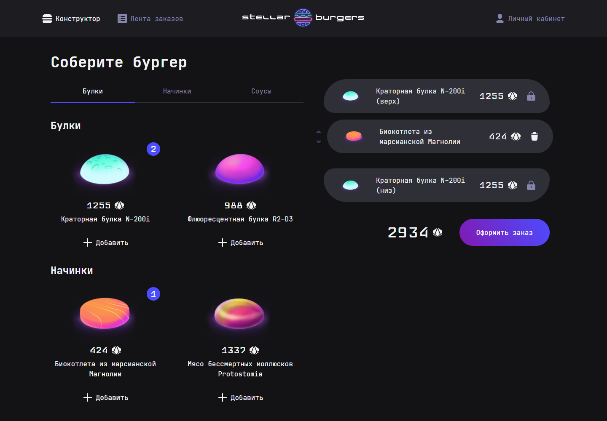

# Stellar Burgers


[Открыть демо](https://nata3552-hub.github.io/stellar-burgers/)

В этом учебном SPA я реализовал космическую бургерную: пользователь собирает бургер из загруженных с сервера ингредиентов, оформляет заказ, просматривает общую ленту и управляет профилем. В проекте я работал с типизированным состоянием, асинхронным REST API, защищёнными маршрутами и автоматизированными тестами.



_Локальный запуск с тестовыми ответами API._

## Что я реализовал

Проект выполнен в рамках курса Яндекс Практикума. На основе предоставленной заготовки я реализовал логику приложения и тестовое покрытие:

- настроил типизированный Redux Toolkit store, предметные слайсы, асинхронные операции и селекторы;
- добавил клиентскую маршрутизацию, защищённые страницы и модальные маршруты;
- связал с состоянием приложения авторизацию, профиль, конструктор, ленту и историю заказов;
- реализовал создание заказа, расчёт стоимости, очистку конструктора и обновление связанных списков;
- обработал загрузку, ошибки запросов и ситуации с устаревшими асинхронными ответами;
- написал интеграционные тесты Redux, прямые тесты редьюсеров и Playwright-сценарии с HAR-моками.

Готовые дизайн, UI kit, презентационные компоненты, базовые стили, API-утилиты, Storybook и конфигурация инструментов входили в заготовку. Backend предоставлен учебной платформой.

## Возможности

- просмотр каталога ингредиентов по категориям и пищевой ценности выбранной позиции;
- сборка бургера с одной заменяемой булкой, несколькими начинками, счётчиками и изменением порядка;
- расчёт стоимости, оформление заказа и очистка конструктора после успешного ответа;
- регистрация, вход, выход, восстановление пароля и редактирование профиля;
- общая лента и личная история с составом, стоимостью и статусом заказов;
- открытие ингредиентов и заказов в модальном окне или отдельной странице по прямой ссылке.

## Технологии

| Инструмент                         | Назначение                                                            |
| ---------------------------------- | --------------------------------------------------------------------- |
| React 19                           | Компонентный интерфейс и формы                                        |
| TypeScript                         | Строгая типизация компонентов, API и состояния                        |
| Redux Toolkit, React Redux         | Слайсы состояния, `createAsyncThunk`, селекторы и типизированные хуки |
| React Router                       | Клиентская навигация, защищённые и модальные маршруты                 |
| Vite                               | Локальная разработка и production-сборка                              |
| CSS Modules, `clsx`                | Изолированные стили и составные CSS-классы                            |
| UI kit Яндекс Практикума           | Базовые визуальные компоненты интерфейса                              |
| Jest, ts-jest                      | Тестирование reducer'ов и Redux-сценариев                             |
| Playwright                         | End-to-end тесты пользовательских сценариев с HAR-моками API          |
| Storybook                          | Изолированная документация и проверка UI-компонентов                  |
| ESLint, Stylelint, Prettier, Husky | Статический анализ, форматирование и локальные проверки               |

## Архитектура

Приложение организовано следующим образом:

```text
src/
├── components/          # контейнеры и обработчики пользовательских действий
│   └── ui/              # презентационные компоненты стартового набора
├── pages/               # компоненты маршрутов
├── services/
│   ├── slices/          # Redux-слайсы и асинхронные операции
│   ├── selectors/       # селекторы областей состояния
│   ├── rootReducer.ts
│   └── store.ts         # store и типизированные Redux-хуки
├── utils/               # API-клиент, cookie и общие типы
└── stories/             # истории Storybook
tests/                   # Playwright-сценарии и HAR-ответы
```

Redux-состояние состоит из отдельных областей для ингредиентов, конструктора, создания заказа, общей ленты, истории пользователя и авторизации. API-вызовы выполняются через асинхронные операции Redux Toolkit; для авторизованных запросов предусмотрено обновление токена. Маршруты собраны в `App`, а детали ингредиентов и заказов используют background location.

## Установка и запуск

Проект использует **npm** — в репозитории находится `package-lock.json`.

Требования:

- Node.js `^20.19.0` или `>=22.12.0` (требование установленной версии Vite);
- npm;
- доступ к backend, указанному в `BURGER_API_URL`;
- Chromium для E2E-тестов Playwright.

```bash
git clone https://github.com/nata3552-hub/stellar-burgers.git
cd stellar-burgers
npm ci
```

Создайте `.env` на основе `.env.example`:

```env
BURGER_API_URL=https://norma.education-services.ru/api
```

Запустите приложение на `http://localhost:4000`:

```bash
npm run start
```

Для локального просмотра production-сборки:

```bash
npm run build
npm run preview
```

<details>
<summary>Все команды проекта</summary>

| Команда                   | Действие                                                                        |
| ------------------------- | ------------------------------------------------------------------------------- |
| `npm run start`           | Запускает Vite dev server на порту 4000                                         |
| `npm run build`           | Создаёт production-сборку в `dist`                                              |
| `npm run preview`         | Запускает локальный просмотр сборки                                             |
| `npm test`                | Запускает Jest                                                                  |
| `npm run e2e`             | Запускает Playwright в headless-режиме                                          |
| `npm run e2e:ui`          | Открывает интерактивный режим Playwright                                        |
| `npm run check`           | Проверяет CSS через Stylelint и TypeScript-код через ESLint без автоисправлений |
| `npm run lint`            | Последовательно запускает Stylelint, ESLint и Prettier с автоисправлениями      |
| `npm run eslint`          | Запускает ESLint с автоисправлением для `src`                                   |
| `npm run stylelint`       | Запускает Stylelint с автоисправлением для CSS                                  |
| `npm run prettier`        | Форматирует файлы в `src`                                                       |
| `npm run storybook`       | Запускает Storybook на порту 6006                                               |
| `npm run build-storybook` | Собирает статический Storybook                                                  |
| `npm run test:storybook`  | Запускает Storybook Test Runner                                                 |
| `npm run storybook:test`  | Поднимает Storybook и запускает его тесты                                       |
| `npm run commit`          | Открывает Commitizen для оформления сообщения коммита                           |
| `npm run deploy`          | Собирает и отправляет содержимое `dist` через `gh-pages`                        |

</details>

Перед первым E2E-запуском установите браузер Playwright:

```bash
npx playwright install chromium
```

## Тестирование

### Jest

Для Redux-логики я написал прямые тесты редьюсеров: проверяются начальное состояние, синхронные действия и состояния `pending`, `fulfilled`, `rejected`. Интеграционные тесты покрывают конструктор, авторизацию, обновление профиля, создание заказа, ленту и защиту от устаревших ответов.

```bash
npm test -- --runInBand
```

### Playwright

В E2E-наборе я проверяю добавление ингредиентов, модальные маршруты, создание заказа, авторизацию, профиль, историю и ленту. Для сценариев конструктора настроил `page.routeFromHAR` и детерминированные ответы из `tests/hars`.

```bash
npm run e2e
```

### Результаты локальной проверки — 4 ноября 2026

- Jest: 31 тест пройден;
- Playwright: 10 E2E-сценариев пройдено в системном Chrome;
- production-сборка Vite завершена успешно.
